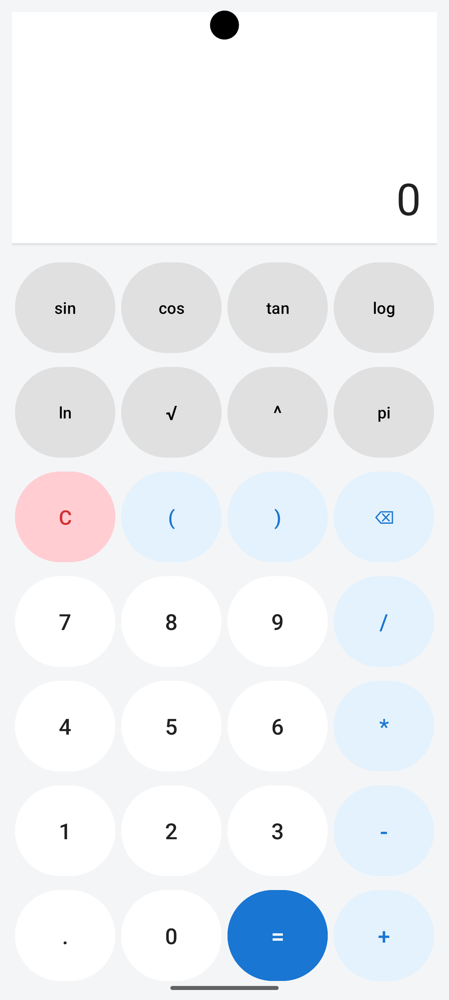

# Scientific Calculator 🧮

A Scientific Calculator Android application built with Kotlin, featuring a clean user interface and support for mathematical calculations.

## ✨ Features

- Basic arithmetic operations
- Scientific calculations
- User-friendly interface
- Android application built with Kotlin
- Expression evaluation using exp4j
- Unit tests for calculator logic

## 🛠️ Technologies Used

- Kotlin
- Android Studio
- XML
- Gradle
- exp4j

## 📱 Requirements

- Android Studio
- Android SDK
- JDK compatible with the project's Gradle configuration

## 🚀 Getting Started

1. Clone this repository:

   bash
   git clone https://github.com/afaqbarki11/Scientific-Calculator.git
   

2. Open the project in Android Studio.
3. Allow Gradle to sync.
4. Run the application on an Android emulator or a connected Android device.

## 🧪 Testing

Run the available unit tests through Android Studio to verify the calculator's logic.

## 👨‍💻 Developer

**Afaq Ahmad**

- GitHub: [@afaqbarki11](https://github.com/afaqbarki11)

## 📸 App Screenshot

  

## 📄 License

This project is available for learning and educational purposes. No separate license has been specified.
